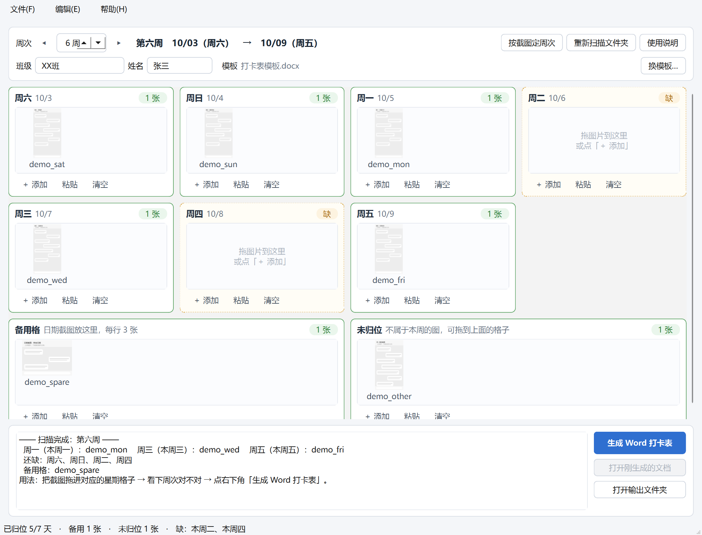

# 一键打卡 · 宣委打卡表生成器

把每周的聊天记录截图拖进界面，**自动按星期几归位、自动算周次、自动填进 Word 模板**，
一键生成《宣委打卡汇报表》。

> 本项目是我自己当宣传委员时为了交打卡表写的，界面是让 DSH 帮忙加的。
> 纯本地运行，截图和生成的文档都只留在你自己电脑上，不联网上传。



## 它能做什么

- **拖拽归位**：把截图从资源管理器拖进对应的星期格子就完事；也能点「＋ 添加」选文件，或者截图后 `Ctrl+V` 直接粘进当前格。
- **自动认周次**：按截图文件名/修改时间里的日期自动推算这是第几周（支持"第1周从周六起算"这种奇怪排法），表格里的日期跟着一起变。
- **缺哪天一目了然**：每格都有「缺 / N 张」标签，底部状态栏汇总，不需要回头看命令行。
- **备用格自动加行**：超过 3 张日期截图会自动往下加一行，一天塞两张图会自动平分高度，不会顶穿一页。
- **排错自己动手**：拖错了再拖到别的格子；不属于本周的图会进「未归位」，不会偷偷丢进表格。
- **随手看大图**：双击缩略图看大图，`←` `→` 翻页，滚轮缩放。
- **整个文件夹能搬走**：程序 + 模板 + 截图放在一个文件夹里，整个搬到 U 盘或另一台电脑都能用；快捷方式会自我修复。

## 快速开始

需要 **Python 3.9+**：

```bash
pip install -r requirements.txt
```

（就是 `PySide6` 和 `Pillow` 两个包。）

然后：

- Windows：双击 `一键打卡.lnk` 或 `一键打卡.pyw`
- 命令行：`python 程序/打卡界面.py`

## 用法三步

1. **拖图** —— 把每天的截图拖进对应的星期格子（周六 ~ 周五），按 `Delete` 删掉拖错的，拖到别的格子就是移动。
2. **看周次** —— 默认按截图日期自动算，认错了用 `◀` `▶` 改；点「按截图定周次」= 按现有截图的日期重新投票。
3. **生成** —— 点「生成 Word 打卡表」，文件会存进 `生成的打卡表/` 文件夹，生成完可以直接打开检查。

第一次用之前，把 `打卡表模板.docx` 换成你们学院现行的模板（名字保持 `打卡表模板.docx` 就行），
程序会自己填班级、姓名和每天的日期。

## 目录结构

```
一键打卡/
├─ 一键打卡.lnk          带图标的快捷方式（平时双击它）
├─ 一键打卡.pyw          同一个入口，放哪都能用；快捷方式失效时用它
├─ 使用说明.txt
├─ 打卡表模板.docx        表格模板：必须保留，可以换成你自己的
├─ 聊天记录截图/          按星期几归位的那批截图（自动创建）
├─ 日期截图/             塞进「备用格」的那批截图（自动创建）
├─ 剪贴板截图/            Ctrl+V 粘贴时自动存的图（用到才出现）
├─ 生成的打卡表/          生成好的 Word 都放这里（自动创建）
└─ 程序/
    ├─ 打卡界面.py        图形界面（主入口）
    ├─ 打卡核心.py        周次推算 / 归位 / 写 Word 的公共逻辑
    ├─ 打卡表.py          命令行版
    └─ 打卡图标.ico
```

界面版和命令行版共用 `打卡核心.py`，两边结果完全一致。

## 命令行版

```bash
python 程序/打卡表.py              # 按截图日期自动定周次并生成
python 程序/打卡表.py --week 6     # 指定第 6 周
python 程序/打卡表.py --check      # 只看截图会被怎么归位，不生成 Word
```

## 关于「搬到别的地方还能用」

Windows 快捷方式里存的是绝对路径，文件夹一搬就会失效。所以这里做了两层保障：

- `一键打卡.pyw` 自己算自己的位置，**放哪都能双击**；
- `一键打卡.lnk` 每次启动都会检查一遍，发现指向旧路径就自动重建（`打卡核心.ensure_shortcut()`）。

搬完家如果快捷方式打不开，双击一次 `一键打卡.pyw` 就修好了。

## 常见问题

**界面打不开 / 一闪而过？**
先确认 Python 和 PySide6 装好了：`pip install PySide6`。也可以直接用命令行版看报错：
`python 程序/打卡表.py --check`。

**提示「找不到模板」？**
确认 `打卡表模板.docx` 还在同一层，没被改名。

**周次算错了？**
界面里用 `◀` `▶` 手动改；或者改 `程序/打卡配置.json` 里的 `first_week_monday`（第 1 周里的那个周一）
和 `cycle_start_weekday`（一个周期从星期几起算，6 = 周六）。

**同一天有好几张图怎么办？**
直接都拖进同一个格子，程序会自动平分高度塞进去。

## 贡献者

| 谁 | 干了什么 |
|---|---|
| [@yyyan44](https://github.com/yyyan44) | 提需求、定周次规则和"周六起算"这种细节、提供打卡表模板、试用挑错 |
| **DSH**（DeepSeek Harness） | 写代码：图形界面、归位/周次/写 Word 的核心逻辑、打包与文档 |

第一版 `打卡表.py` 是人写的（见 `程序/旧版备份/`），后来界面和重构是 DSH 加的 —— 规则归人，实现归它，两边一起磨出来的。

## 免责

这个工具只做"把图填进 Word 模板"这件事，模板格式、周次规则以你们学院的要求为准。
截图内容请自己注意隐私，仓库里的 `.gitignore` 已经默认不上传截图、生成的文档和个人设置。

## 许可

[MIT](LICENSE)
