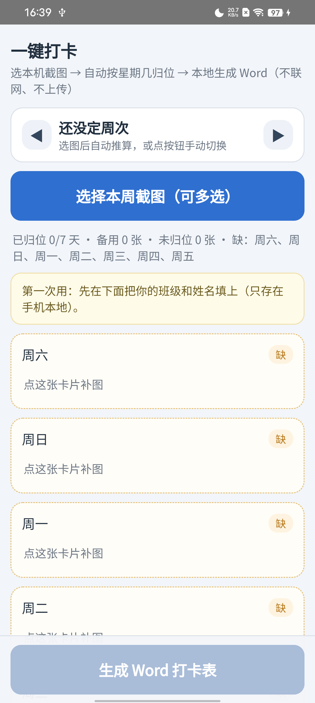
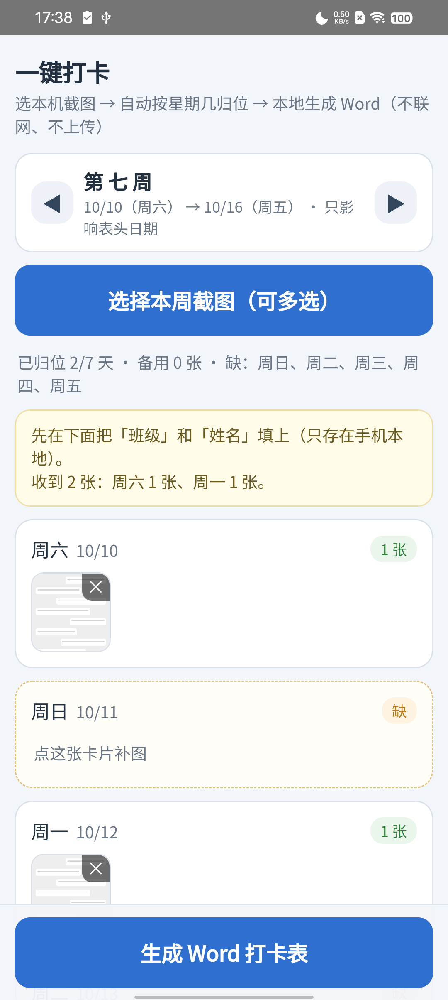
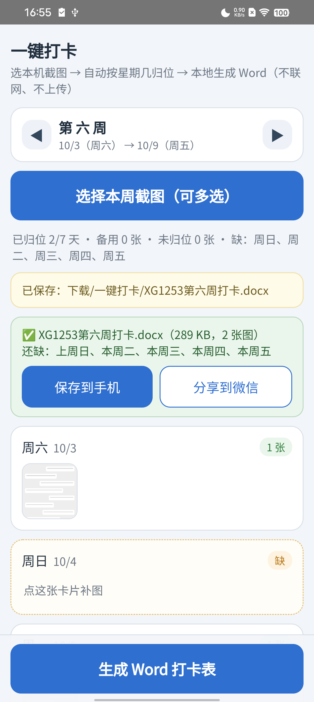

# 安卓版 · 一键打卡

手机上的同一件事：**选本机截图 → 按星期几归位 → 本地生成 Word 打卡表 → 存到手机 / 分享到微信**。
不需要电脑、不需要网络、不需要装 Office。

| 首页 | 归位 | 生成完成 |
|---|---|---|
|  |  |  |

## 跟电脑版的三点不同

1. **只按「星期几」归位，不按截图日期猜周次。** 我经常是这周的打卡下个周末才补，按日期猜周次反而会把图丢进"未归位"。所以周次由你自己用 `◀ ▶` 定（默认本周），**它只决定表头那行日期**。
2. **界面是手机竖屏优先的**：每天一张卡片，点卡片补图，点缩略图看大图，右上角 `×` 删，长按卡片清空那一天。
3. **生成的文档存在 `下载/一键打卡/`**，同名直接覆盖（不会攒出一堆 `(1)`），生成完可以「打开看看」「存到手机」「分享到微信 / QQ」。

## 隐私

- `AndroidManifest.xml` **没有声明 `INTERNET` 权限** —— 系统层面就没有联网能力，装完可以在「应用信息 → 权限」里看到「未请求任何权限」。
- 选中的图只存在 App 私有存储（IndexedDB）里，卸载即清空；生成的 docx 写进公共「下载」目录。
- 模板、周次规则、班级姓名全部存在手机本地。

## 安装

**本仓库不提供预编译的 APK**，因为生成打卡表需要模板，而模板（学院发的表格）会整份打进 APK 里 ——
那等于把模板公开出去，所以 `assets/template.js` 和 APK 都不进仓库。请按下面「自己构建」打包，用你自己的模板。

要求 **Android 8.0（API 26）及以上**。Android 10 以下的机器会把文档存进 App 私有目录、不支持直接分享。

> ⚠️ 用 debug 签名自己装没问题；要正式发布请换成 release 签名，且换签名后必须**先卸载再装**。详见文末「签名」。

## 自己构建

```bat
:: 0) 把你们学院的模板命名为 打卡表模板.docx 放到仓库根目录（就是 一键打卡.pyw 旁边）
python tools\extract_template.py

:: 1) 一次性：生成 debug 用 keystore（本仓库不提交 keystore）
keytool -genkeypair -v -keystore daka-debug.keystore -storepass android -keypass android ^
        -alias androiddebugkey -keyalg RSA -keysize 2048 -validity 10950 ^
        -dname "CN=Android Debug,O=Android,C=US"

:: 2) 然后每次构建
构建.bat
```

第 0 步生成 `app/src/main/assets/template.js`（模板的 OOXML 部件，209 KB 左右），它已在 `.gitignore` 里；
缺了它 App 能打开但会提示「没有模板数据」，不会崩。

产物：`app\build\outputs\apk\debug\app-debug.apk`（同时会复制一份成 `一键打卡_验证版.apk`）。

离线构建的前提是本机能解析 Android SDK 与 AGP 依赖；`构建.bat` 会自动找 `_gradle-home`（本机的离线 Gradle 缓存），
找不到就退回 `%USERPROFILE%\.gradle`。`local.properties` 里的 `sdk.dir` 是这台电脑的路径，已在 `.gitignore` 里，换机器要自己生成。

## 代码结构

界面和逻辑全在网页里（`assets/`），Java 只是壳：

```
安卓版/
├─ app/src/main/java/com/yyyan44/daka/MainActivity.java
│    壳：WebView + 相册多选 + 写文件（MediaStore）+ 打开/分享
├─ app/src/main/assets/
│  ├─ index.html      界面结构（竖屏、卡片式）
│  ├─ app.js          交互：选图 / 归位 / 周次 / 持久化（IndexedDB）/ 进度
│  ├─ core.js         周次与归位算法（node 可单测）—— 电脑版 打卡核心.py 的 JS 移植
│  ├─ docx.js         手写 zip + OOXML：把图塞进模板、改班级姓名、直接吐 Blob
│  └─ template.js     由 tools/extract_template.py 生成（含模板的 221 个部件；不进仓库，模板自备）
├─ tools/
│  ├─ extract_template.py   模板 docx → assets/template.js
│  ├─ make_icons.py         ico → 各密度 mipmap（含自适应图标）
│  ├─ test_core.js          核心算法自测（node 安卓版/tools/test_core.js）
│  ├─ check_docx.py         生成物结构校验 + WPS 打开验证
│  └─ e2e_test.ps1          真机端到端验收（构建→安装→选图→生成→拉回→校验）
└─ docs/                    截图与图标源文件
```

没有引任何第三方库（不用 AndroidX、不用 Kotlin 插件）：zip 手写（stored + 自己算 CRC32）、
OOXML 用 `DOMParser`/`XMLSerializer` 改、图片用 canvas 转 JPEG。所以 APK 只有几百 KB。

## 已知限制

- 大图预览还不能双指缩放、不能左右翻同一张卡片里的多张。
- 未归位的图点一下固定收进"它自己的星期几"，想指定别的天要长按卡片清空重选。
- 模板是打包在 APK 里的，学院换模板要重新打包（下一步做"上传自定义模板"）。
- 分享是单文件 `ACTION_SEND`，不支持一次发多份。

## 签名

正式发布要用自己的 release keystore（`*.keystore` 已在 `.gitignore` 里，不会误提交）：

```bash
keytool -genkeypair -v -keystore daka-release.keystore -alias daka \
        -keyalg RSA -keysize 2048 -validity 10950 -storepass 你的密码 -keypass 你的密码 \
        -dname "CN=你的名字,O=personal,C=CN"
```

然后把 `app/build.gradle.kts` 里的 `signingConfigs` 换成这个 keystore（或写进 `keystore.properties` 并 gitignore）。

**keystore 丢了就永远无法对同一个 App 发布更新**，请多处备份。
